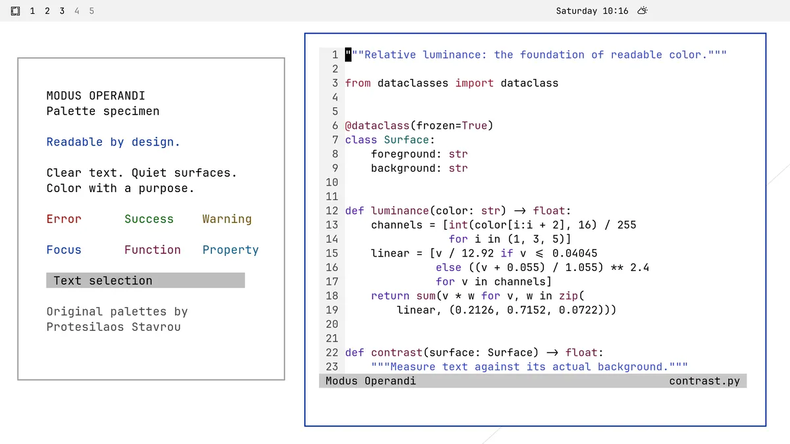
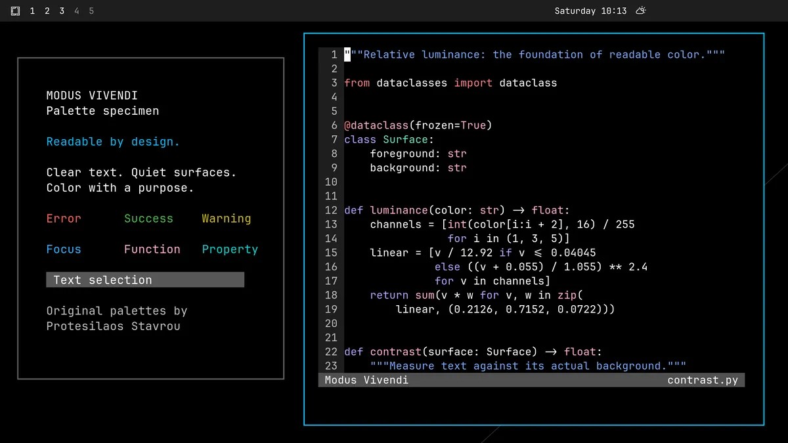

# Modus Themes for Omarchy

Two desktop themes based on **Modus Operandi and Modus Vivendi by
[Protesilaos Stavrou](https://protesilaos.com/)**. They share an interaction
language and build tooling, while each uses its own upstream palette.

| Modus Operandi | Modus Vivendi |
| --- | --- |
| White canvas, dark ink, restrained blue focus | Black canvas, luminous text, cool blue focus |
|  |  |

This is an independent port, not an official Modus Themes project. The
palettes are from Modus Themes 5.2.0 in Emacs 31.1. Both variants target
Omarchy 4.0.2's Quickshell and Lua Hyprland theme system.

## Install both themes

Clone the package, review its configuration and installer, then register the
two theme directories:

```bash
mkdir -p "$HOME/Projects"
git clone https://github.com/codingquark/omarchy-modus-themes \
  "$HOME/Projects/omarchy-modus-themes"
cd "$HOME/Projects/omarchy-modus-themes"
bash install.sh
```

The installer creates local symlinks under `~/.config/omarchy/themes`, registers
the Cliamp palettes and theme-change hook, refuses to replace unrelated files
or themes, and leaves the current desktop theme active. If a Modus theme is
already active, it also applies the matching Cliamp palette.
Running it again is safe. No downloads, dependency installations, or build
steps happen inside the installer.

Choose either theme in Omarchy's picker, or run:

```bash
omarchy theme set modus-operandi
omarchy theme set modus-vivendi
```

An optional argument to `bash install.sh modus-vivendi` registers both and
applies Vivendi. This is a multi-theme package: **do not pass this repository
to `omarchy theme install`**, which expects one theme at the repository root.
The local symlinks also preserve the reviewed per-application configurations;
Omarchy regenerates terminal and Lua configs when importing single-theme Git
repositories directly.

To update, pull changes in the checkout, rerun `bash install.sh` to register
new integrations, and reapply your selected theme.
To uninstall, switch to another theme and remove only the two installed
theme symlinks, `~/.config/cliamp/themes/modus-{operandi,vivendi}.toml`, and
`~/.config/omarchy/hooks/theme-set.d/85-cliamp-modus`.
The checkout can remain for future use.

## Design

Both themes use opaque reading surfaces, restrained chrome, visible blue
focus outlines, and separate treatments for completion and text selection.
Colors indicate function. They are not simple inversions of each other.

The original non-tinted palettes provide room for highly legible text. Code
uses blue strings, magenta functions, cooler magenta keywords, cyan variables,
and gray comments. Numbers and punctuation stay neutral. Headings use weight
and a restrained hierarchy. Current code lines retain the main canvas, with
position indicated in the gutter so syntax contrast is not reduced.

Some desktop surfaces need contextual adjustments:

- Operandi uses `#474747` for secondary chrome text, keeping it readable on gray surfaces.
- Vivendi uses `#bfbfbf` for secondary chrome text and a lighter red for alerts on the bar.
- Vivendi's selection is slightly darker than upstream, so white selected text clears 7:1.
- Vivendi uses subdued yellow and cyan search backgrounds and white completion-match text.
- Refined diff text uses the main foreground on the highlighted background.

The wallpaper pair uses the same original vector geometry: spacious paper
planes with a small blue registration line, without logos or fine texture.
The SVG colors come from each variant's own palette. The files under
`screenshots/` show real desktop sessions; the build derives each theme's
`preview.png` from its matching desktop screenshot for Omarchy's theme picker.

## Coverage and limits

- Quickshell bar, popups, notifications, launcher, menus, controls, authentication, and lock input.
- Hyprland borders, grouped-window labels, and opaque default application windows.
- Ghostty, Kitty, Alacritty, and Foot, including cursor and selection colors.
- Cliamp, btop, Helix, LazyVim/Neovim, and VS Code's local Omarchy theme.
- Native light/dark mode, coordinated Yaru icons, and browser tint.
- Other Omarchy integrations receive each theme's explicit semantic palette through installed templates.

GTK applications use Omarchy's Adwaita integration. User overrides take
precedence. Existing Emacs or HEY integration hooks and templates continue
to participate if installed; this package does not install those integrations.
The Neovim themes are self-contained for LazyVim and need no additional theme
plugin. Switching between the two Modus themes uses Omarchy's normal command
and reload hooks; the package does not change application keybindings.

The 16 ANSI slots retain their upstream values, independently of desktop
surface roles. ANSI white on white, black on black, dim escape sequences,
and app-selected true-color combinations can be unreadable. Some running
programs need reopening after switching themes, and existing true-color
scrollback does not automatically change.

Cliamp (the music TUI on `Super+Shift+Alt+M`) gets explicit primary, secondary,
selection, and status colors because its default ANSI palette assumes a dark
terminal. The included hook updates a running Cliamp 2.x through its theme
command and saves the selection for the next launch when it is closed. It
preserves other configuration keys and backs up an existing config once to
`config.toml.before-modus`. Leaving Modus restores Cliamp's terminal palette
if its saved theme is still one of ours; other manually selected themes are
left alone. Cliamp's `CLIAMP_CONFIG_DIR` and `XDG_CONFIG_HOME` overrides are
honored when present in the installer and hook environment.

This is **not a claim of universal desktop WCAG conformance**. Authored text
and focus pairs are checked, but every third-party application, plugin, and
website has not been audited. When reporting a problem, include the variant,
application, and affected state.

## Build and check

```bash
node build.mjs                  # Build both variants
node build.mjs modus-vivendi    # Build only the dark variant
node check.mjs                  # Check both contrast manifests
node --test                     # Check template rendering regressions
```

Building requires Node, ImageMagick, and Omarchy 4's installed templates.
`OMARCHY_PATH` can point to another Omarchy checkout. Installation uses the
committed output and does not require these build tools.

The builder supports palette keys, `_strip`/`_rgb` modifiers, and Omarchy's
`mix`, `mix_strip`, and `mix_rgb` expressions. Unsupported expressions or
unresolved placeholders fail the build instead of entering generated configs.

`palettes/` contains resolved upstream palette snapshots; `build.mjs` defines
shared face mappings and explicit per-variant surface adaptations. It writes
application configurations and contrast manifests under `themes/`, plus SVG
artwork under `artwork/`. Edit those source inputs for durable changes.

Each theme checks 112 authored color pairs, including Cliamp text, secondary text,
selection, search, control states, focus borders, and Neovim faces. Text pairs
must reach 7:1; focus indicators must reach 3:1. These measurements complement
configuration validation and live desktop inspection.

## Credits and license

**Original themes, palettes, and design principles: Protesilaos Stavrou.**
Modus Themes carries copyright 2019-2026 Free Software Foundation, Inc., and
is distributed under GPL-3.0-or-later. This port retains that license; see
[LICENSE](LICENSE). The Omarchy adaptation and original wallpaper are by
Dhavan Vaidya, 2026. Adapted Omarchy templates retain their MIT notice in
[THIRD_PARTY_NOTICES.md](THIRD_PARTY_NOTICES.md).

Prot's work is the foundation of this project. Consider
[supporting Prot directly](https://protesilaos.com/donations/) if you find it
useful. Donations are optional and confer no special rights or endorsement.

- [Modus Themes manual and guidance on ports](https://protesilaos.com/emacs/modus-themes).
- [On the design of the Modus themes](https://protesilaos.com/codelog/2020-03-17-design-modus-themes-emacs/).
- [Colour theory and techniques used in the Modus themes](https://protesilaos.com/codelog/2022-04-21-modus-themes-colour-theory/).
- [Upstream source](https://github.com/protesilaos/modus-themes).

This port does not imply endorsement by Protesilaos, the Free Software
Foundation, or Omarchy. Its documentation describes the adaptation in its
own words rather than reproducing the upstream manual.
